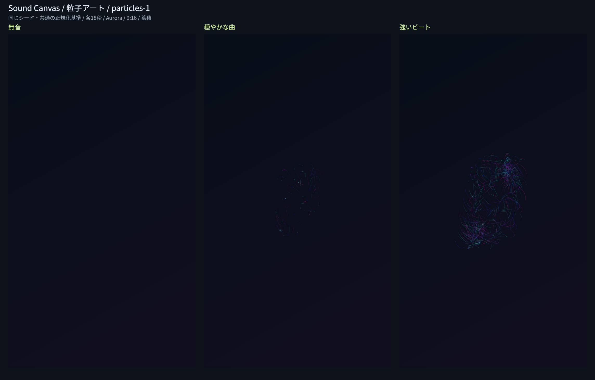

# Issue #10：粒子アート

## 実装と比較

高音で細かな粒子、低音で拡散、中音で旋回、盛り上がりで密度と速度、ビートで追加発生を表す。粒子の移動線は蓄積層、光点は演出層。無音では新規発生せず、既存粒子は寿命まで動く。最大256個・発光32個/ステップに制限し、寿命と速度にも上限を設けた。状態と乱数、発生数の端数を復元する。曲線・幾何学との単独切替、全テーマ・3比率・蓄積/減衰は共通基盤を使う。

実Canvasの720×1280画像を配置し、明るさ・色の後処理はしていない。合成PCM54秒（22.05kHz、無音18秒・穏やかな和音18秒・強い低音ビートと高音18秒）を1回解析し、各区間を同じシード2304706556で独立生成した。Aurora、反応100%、蓄積。個人の楽曲は使わない。

| 区間 | 平均volume | 平均intensity | ビート数 | 変化画素 |
| --- | ---: | ---: | ---: | ---: |
| 無音 | 0 | 0 | 0 | 0 |
| 穏やかな曲 | 0.11285 | 0.11124 | 0 | 2,717（0.295%） |
| 強いビート | 0.34112 | 0.43774 | 35 | 23,236（2.521%） |

変化画素は背景とのRGB差がいずれか8超の画素であり、作品の質の指標ではない。目視でも静かな区間の繊細な線と強い区間の密度差を確認した。[測定データ](assets/particles-metrics.json)に全条件を保存した。

## 確認結果

2026-11-12、Windows / Node.js 24。`npm test` は121件成功（既存100件＋粒子21件）。粒子では帯域・音量・強さ・ビート・盛り上がり、テーマ、無音、境界反射、256個と32発光の上限、寿命、10分相当の有限状態、reset/dispose、不正復元の原子性、乱数を含む再生成を確認した。記録用Canvas代替でのテストを実画素試験とは扱わない。

WindowsのCodex内ブラウザ（UA Chrome/157.0.0.0）でローカル配信し、実Canvas比較80件が成功した。

- 描画基盤72件：3層基本3件、3スタイル×3比率×3テーマ×両軌跡の復元54件、曲末保持と合成頻度6件、実出力解像度PNGの再デコード9件。
- 粒子比較8件：無音・穏やか・ビートの3区間、区間差、最大反応での3比率の余白、5分蓄積と曲末復元。

復元の画素比較は36×64/64×36/48×48。PNGは720×1280/1280×720/1080×1080。5分は180×320・9,000フレーム・反応200%で、変化面積28.019%、白画素（RGBすべて245超）0、短辺2%の外周の変化0、最終粒子241個。最後の1秒を復元した画素・内部状態が連続生成と一致した。3出力比率の最大反応でも外周の変化0。

通常画面では、読込前の粒子選択、解析中の3スタイルの無効化と選択保持、デモ再生、10秒シーク、再生中の粒子→曲線→幾何学→粒子、Ocean・減衰・16:9への変更を確認した。

## 再実行と制限

ルートで `npm test`。`python -m http.server 8771 --bind 127.0.0.1` で配信し、以下を開く。

- `http://127.0.0.1:8771/tests/organic-browser.html?style=particles`：比較とPNG・測定データの保存。ページは全スタイル共用。
- `http://127.0.0.1:8771/tests/rendering-browser.html`：画素・復元・PNG。
- `http://127.0.0.1:8771/dist/`：通常操作。

小さなCanvasの5分生成とNodeの10分シミュレーションは、実音源・フル解像度の長時間再生や録画性能を保証しない。実音源・他ブラウザ・大容量は#18、全4スタイルの再現性は#13、復元高速化は#14、動画は#15/#16、完成PNG専用操作は#17。水彩は#11、設定の仕上げは#12で進める。
