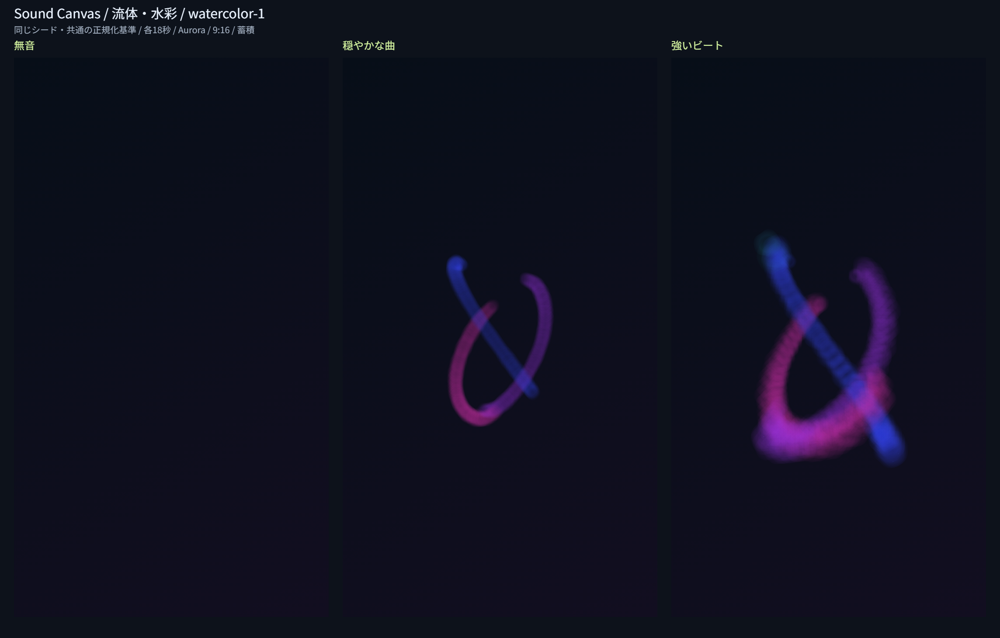

# Issue #11：簡易流体・水彩

## 実装範囲

`watercolor-1` を登録し、4つの描画スタイルを選べるようにした。低音で大きな色の塊、中音で流れ、高音で細かな顔料、盛り上がりで移動速度と塗りの密度、音量で濃さ、ビートで短く広がるにじみを表す。半透明の塗り、放射状グラデーション、固定シード由来の滑らかな輪郭変形による簡易表現で、本格的な流体計算や顔料の物理混色ではない。

塗りは描画層に残り、ビートのにじみは演出層で最大18個・寿命1.1〜1.6秒。無音では新しい塗りを発生させず、既存演出だけが消えていく。曲末はその時点の合成画面を固定する。全テーマ・3比率・蓄積/減衰とPNGを共用する。時計・スタンプ発生数の端数・にじみ・乱数を復元する。

## 比較画像

実Canvasの720×1280画像を配置した。色・明るさの後処理はない。合成PCM54秒（22.05kHzモノラル）を一度解析し、無音・穏やかな和音・強い低音ビートと高音の各18秒を独立生成した。共通シード2304706556、Aurora・反応100%・蓄積。同じ条件を既存スタイルの比較でも用いている。個人の楽曲は含まない。

| 区間 | 平均volume | 平均intensity | ビート数 | 変化画素 |
| --- | ---: | ---: | ---: | ---: |
| 無音 | 0 | 0 | 0 | 0 |
| 穏やかな曲 | 0.11285 | 0.11124 | 0 | 38,599（4.188%） |
| 強いビート | 0.34112 | 0.43774 | 35 | 101,622（11.027%） |

変化画素は初期背景からRGBいずれかが8を超えて変化した画素。密度の参考であり、作品の質の評価ではない。目視でも穏やかな細い色の流れと、強い区間の広いにじみを確認した。全数値・環境は[測定データ](assets/watercolor-metrics.json)。

## 減衰の消え残りの修正

最初の5分確認でEmberの減衰に灰色の残留が見つかった。8ビットCanvasで小さなdestination-outを毎ステップ重ねると、透明度と色の丸めによる残留が増える。共通エンジンを `sc-renderer-3` に更新し、4ステップ（約0.133秒）分の減衰をまとめて適用するようにした。1/30秒あたり0.018の指数減衰を基準とし、終端は未処理分と端数dtを反映する。

これは全スタイルの減衰結果を変更する。蓄積モードには適用しない。版が異なる保存状態を拒否し、減衰の位相は保存済みのフレーム番号から再現する。30秒間の実Canvas減衰で残留alphaが8以下になることを検証した。完全な透明への収束を保証する処理ではない。

## 確認結果

2026-11-12、Windows / Node.js 24。`npm test`：142件成功（従来121件＋水彩20件＋共通減衰1件、既存の減衰テストも更新）。記録用Canvas代替で、帯域・音量・ビート・強さ・盛り上がり、全テーマ、3比率の境界、無音、寿命と状態上限、固定シード、乱数と端数を含む復元、10分相当の有限状態、不正復元の原子性、端数時間、解放を確認した。Nodeの結果を実画素試験とは扱わない。

Windows / Codex内ブラウザ（UA Chrome/157.0.0.0）の実Canvasで110件成功。

- 共通96件：3層基本3、減衰残留1、4スタイル×3比率×3テーマ×両軌跡の復元72、曲末保持と合成頻度8、実出力サイズPNG再デコード12。
- 水彩14件：音源3区間、区間差、3比率の最大反応、5分蓄積と曲末復元、全テーマ×両軌跡の5分確認6。

共通の復元比較は36×64/64×36/48×48。PNG再デコードは720×1280/1280×720/1080×1080。水彩5分は180×320、9,000ステップ、反応200%、合成特徴列を使用した。

| テーマ | 蓄積の変化面積 | 減衰の変化面積 | 変化画素内の有彩色率（両軌跡） |
| --- | ---: | ---: | ---: |
| Aurora | 50.028% | 23.207% | 100% |
| Ember | 50.078% | 23.366% | 100% |
| Ocean | 50.045% | 23.160% | 100% |

有彩色率は変化画素のうち `(max(RGB)-min(RGB))/max(RGB) > 0.25` の割合。90%超、変化面積0.1〜85%、白画素0.1%未満、短辺2%の外周変化0を判定基準とした。全6設定で白画素（RGB全て245超）0、外周変化0。これは簡易指標であり、全楽曲の色の美しさを保証しない。Aurora蓄積の最後の演出は3個で、最後の1秒を保存から復元した画素と状態が連続生成と一致した。

通常画面では、読込前の水彩選択、解析中の4スタイルの無効化と選択保持、デモ再生、10秒シーク、再生中の水彩→曲線→幾何学→粒子→水彩、Ember・減衰・16:9への変更、一時停止とPNGダウンロードを確認。保存PNGの1280×720を確認した。

## 再実行と未確認

ルートで `npm test`。`python -m http.server 8773 --bind 127.0.0.1` で配信する。

- `http://127.0.0.1:8773/tests/organic-browser.html?style=watercolor` で比較・長時間検証とPNG/データ保存。
- `http://127.0.0.1:8773/tests/rendering-browser.html` で4スタイルの画素・復元・PNG比較。
- `http://127.0.0.1:8773/dist/` で通常操作。

修正時は古いモジュールのキャッシュを避け、最新コードが配信されていることを確認する。実施時も配信ポートを変更して最終版を確認した。開発用ページはdistの公開対象に含めない。

小さなCanvasの5分生成やNodeの10分計算は、実音源・フル解像度の長曲再生や動画録画の性能保証ではない。実音源・主要ブラウザ・大容量は#18、設定の統合仕上げは#12、4スタイルの再現性は#13、復元高速化は#14、動画は#15/#16、完成PNG専用操作は#17で進める。
