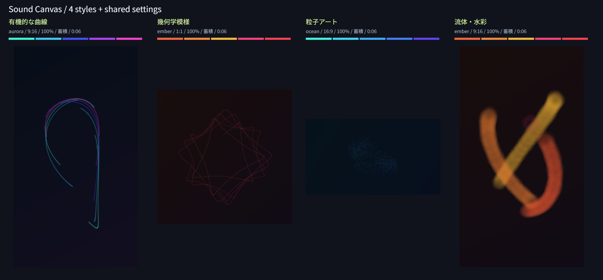

# Issue #12：4スタイルの設定と表示の統合

## 変更

設定パネルをSettingsPanelへ分離し、曲線・幾何学・粒子・水彩の選択、3テーマ、反応、軌跡、比率を接続した。テーマの色見本を実際の色相定義から作る。スタイルと比率の押下状態、入力値、出力サイズはRendererの設定から同期し、UIだけが別の設定を選択した状態にならないようにした。

反応スライダーは操作中の値を画面更新で上書きせず、確定時に描き直す。取り消しは適用済みの値へ戻す。同じ設定や比率を選び直した場合は再計算を省き、再生や進行中の復元を中断しない。設定が拒否された場合は前の描画と設定を保つ。

未読込では設定可能、読み込み中は全設定を無効化する。復元中は次の設定を選べ、最後の要求だけを反映する。読み込み・復元中は設定欄に説明を表示し、比率にも単独選択の押下状態を付けた。

## 比較画像

同じシード12345・合成特徴列6秒を、設定欄から選択して描いた実Canvasの比較。ラベルと色見本を付け、出力比率を保って縮小配置した。明るさや色の補正はしていない。音声ファイルは含まない。

| スタイル | テーマ | 比率 | 反応・軌跡・時刻 |
| --- | --- | --- | --- |
| 曲線 | Aurora | 9:16 | 100%・蓄積・6秒 |
| 幾何学 | Ember | 1:1 | 同上 |
| 粒子 | Ocean | 16:9 | 同上 |
| 水彩 | Ember | 9:16 | 同上 |

## 自動確認

2026-11-12、Windows / Node.js 24。`npm test` は148件成功（既存142件＋設定関連6件）。変更のない選択の再生維持、復元中の変更なし要求、連続した全設定とシーク、読み込み中の拒否と中止後の復帰、不正な設定の拒否、復元中の拒否後の再生時期を確認した。記録用描画代替による検証で、実画素比較は以下で別に行った。

## ブラウザ統合確認

Windows / Codex内ブラウザ（UA Chrome/157.0.0.0）、ローカルHTTP配信。実Canvas・本番の設定パネル・実コントローラーと描画エンジン（sc-renderer-3）を使い、224件成功。

216件は4スタイル×3テーマ×2軌跡×3比率×3反応（25%・100%・200%）。各組合せを実際の入力イベントとクリックから設定し、0.4秒へ移動して、別Rendererの冒頭からの生成と画素・内部状態を比較した。出力サイズは720×1280、1280×720、1080×1080。色見本、単独選択、入力値、サイズ表示、描画完了後のPNG可否も一致した。

残る8件で以下を確認した。

- 初期値が曲線・Aurora・100%・蓄積・9:16で、未読込では設定可能、PNG不可。
- 読込前の設定を読み込み後も保持し、解析中は全設定を無効化する。
- 反応入力163%を画面更新で戻さず、確定時だけ描き直す。入力の取り消しで163%へ戻る。
- 同じスタイル・比率の選択で再計算や再生中断をしない。
- 復元の途中でスタイル・テーマ・軌跡・比率・反応・シークを重ねても、最後の2秒位置と選択内容だけが残り、参照描画と一致する。
- 不正な設定後は前の描画・選択・再生を保持する。
- 読込失敗後に設定と保存可能な描画へ戻る。
- 読込中止で再び設定でき、古い読込の完了が結果を上書きしない。

合成特徴列はtests/organic-fixtures.jsのorganicStressを6秒分使う。音声出力は制御可能なテスト時計で置き換えており、224件を実音源の音声再生試験とは扱わない。条件と全結果は[確認データ](assets/settings-metrics.json)。216通りの比較時刻は0.4秒であり、長曲の再現性全体を保証するものではない。

## 通常画面の確認

デモ音源と通常のWeb Audio再生で、水彩・Ember・1:1を読込前に選び、解析中の無効化と選択保持、再生、10秒シークを確認した。再生中に粒子・Ocean・反応200%・減衰・16:9へ変更し、位置と再生意図、表示が維持されることを確認した。一時停止後にOceanの5色見本・200%表示・粒子選択を目視した。

## 再実行と残る範囲

1. ルートで `npm test`。
2. `python -m http.server 8774 --bind 127.0.0.1` でルートを配信。
3. `http://127.0.0.1:8774/tests/settings-browser.html` で「設定の検証を実行」。成功後に比較PNGと確認データを保存できる。プレビュー内の操作は検証終了時に無効にする。
4. `http://127.0.0.1:8774/dist/` でデモの再生と設定を確認。

描画スタイルと共通Rendererの計算は変更していない。PNGの再デコード、長時間の色と境界の過去結果は[水彩の記録](issue-11-validation.md)を参照する。今回それらの過去件数は再実施件数に加えていない。

動画と完成PNG専用処理は未実装で、生成中の排他制御は#15/#17で接続する。全4スタイルの中間・終端を含む再現性は#13、復元高速化は#14、実音源・他ブラウザ・長曲は#18、キーボードなどUI全体の仕上げは#19で確認する。
