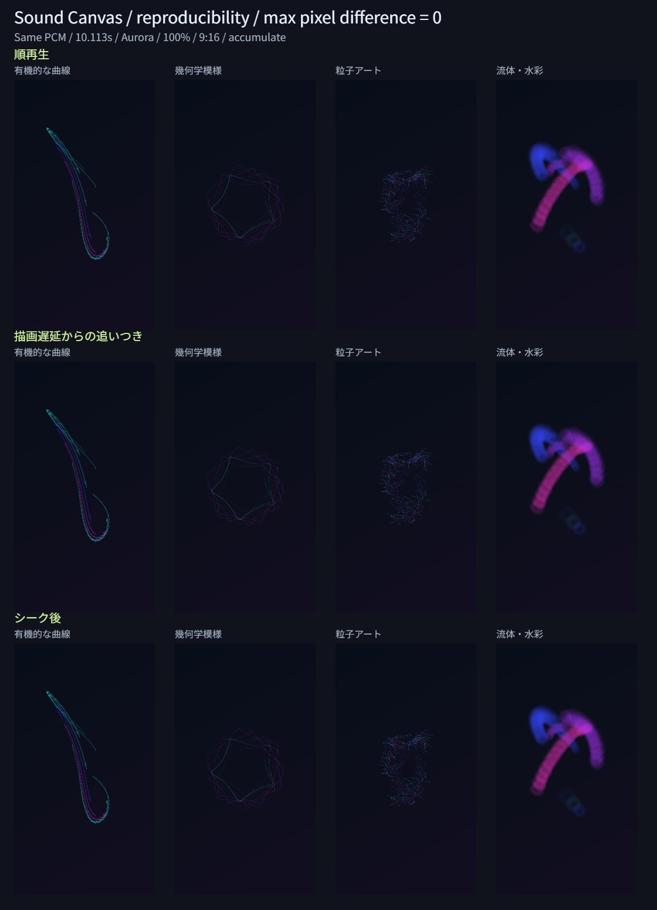

# Issue #13：時刻・停止・遅延・シークの再現性

## 修正した境界の問題

30Hzの時刻境界に浮動小数点誤差があり、4.1秒で123コマではなく122コマ、31/30秒の曲末で31コマではなく32コマになる場合があった。timing.jsで整数に十分近いコマ数を補正し、解析と描画で同じframeCount・端数dtを使うようにした。音声時刻も `offset + (currentTime - started)` の順に計算して加減算の桁落ちを抑えた。

補正閾値は `max(1e-8, 4 * Number.EPSILON * max(1, abs(time*30)))` コマ。固定下限の1e-8コマは約0.33ナノ秒で、通常の音声サンプルより十分短い。境界から離れた端数や、48kHzで余る最後の1サンプルは維持する。解析はsc-analysis-3、描画はsc-renderer-4へ更新した。旧版の保存状態は拒否する。4スタイルの描画式と乱数方式は変更していない。

## 比較画像

各列が4スタイル、各行が順再生・描画遅延からの追いつき・シーク後。実出力720×1280を比率を保って縮小配置した。色や明るさの補正はない。一致判定は縮小前のRGBAを比較して行った。

同じ合成PCM（8kHz、2チャンネル、80,904サンプル、10.113秒）を事前解析して使った。冒頭0.4秒は無音、低音パルス・中音・高音と区間の強弱変化を含む。個人の楽曲は使用していない。共通シード3116582953、Aurora・反応100%・蓄積・9:16、曲末304コマの画像。

## 合格条件と環境

2026-11-12、Windows / Node.js 24、Codex内ブラウザ（UA Chrome/157.0.0.0）、ローカルHTTP配信。

同一PCM解析結果、シード、設定、時刻、解像度、エンジン版で、合成画面と内部3層のRGBA差0、スタイル状態JSONと乱数の差0を条件とした。画素差への許容幅は設けていない。時刻境界の誤差補正と画素の許容差は別の規則である。環境・識別・版・条件・SHA-256を[確認データ](assets/reproducibility-metrics.json)に保存した。

## Nodeの自動確認

`npm test`：157件成功（従来148件＋9件）。追加したのは以下。

- 10分までの全18,000コマの整数境界、境界の前後の実端数、短曲と端数dt、複数サンプルレートの曲末（4件）。
- 44.1/48kHzの31/30秒が31コマで終わり、1サンプル余れば32コマになる解析（2件）。
- 遅延時の90コマずつの追いつき、停止・再開時の音声時刻と順序、端数に見える整数境界の曲末（3件）。

既存の解析フレーム数の確認も共通規則に更新した。Nodeの描画代替を使う確認を、実Canvasの画素試験として扱わない。

## ブラウザの90ケース・1,432組の比較

| 種別 | ケース数 | 条件 |
| --- | ---: | --- |
| PCM再解析 | 1 | 処理の分割方法を変えても識別・シード・全特徴列が一致 |
| 全設定の再現性 | 72 | 4スタイル×3テーマ×2軌跡×3比率 |
| 実出力サイズ | 12 | 4スタイル×720×1280 / 1280×720 / 1080×1080 |
| 整数境界の曲末 | 4 | 各スタイル、48kHz・49,600サンプル・31/30秒 |
| 保存状態のキー | 1 | 版・曲・設定・解像度等の11種類の不一致を拒否 |

90ケースすべて成功。1,432組それぞれで合成・背景・描画・演出の4画像と内部状態を厳密比較した。最大RGBA差は0。

72ケースの検証解像度は90×160・160×90・128×128で、反応はそれぞれ25%・100%・200%。各比率内では全テーマ・両軌跡を試した。実出力サイズの12ケースはAurora・蓄積・100%。全テーマ・軌跡・反応・実出力サイズの完全な直積を実施したとは扱わない。

72＋12ケースの各ケースでは、以下の17組を比較した。

1. 0秒、31/30秒、4.1秒、8.417秒、曲末の0.001秒前、曲末の順再生（6組）。
2. 冒頭から曲末へ音声時計を一度に進め、1回90コマ以内で追いつく（1組）。追いつき前は保存不可。
3. 4.1秒で停止し、時計を11秒進めても画面と状態を保持する。再開して曲末へ進む（2組）。
4. 8.417秒→31/30秒→4.1秒→0秒→曲末のシーク（5組）。
5. 4.1秒のスナップショットから曲末へ復元する（1組）。
6. テーマ・反応を変えて元の設定へ戻す（1組）。
7. 同じPCMを再解析し、別ファイル名として読み直して曲末へ進む（1組）。

曲末後の追加tickで画像・状態が変わらないことも確認した。31/30秒の短曲は31コマで停止し、余分な32コマ目を受け付けなかった。保存キーの不一致は、描画版・スタイル版・シード・曲の識別・解析版・長さ・スタイル・テーマ・反応・軌跡・幅で試し、拒否前後の画素と状態も一致した。

実AudioEngine・StudioController・Rendererを使い、音声出力だけを制御可能な時計とソースに置き換えた試験である。実時間の音声再生や録画同期の試験ではない。試験の「順再生」は全ステップを順に消費することで、毎画面更新が必ず30Hzで呼ばれるという意味ではない。

## 通常画面の確認

デモ音源を水彩・Aurora・100%・減衰・9:16で読み込み、通常のWeb Audio再生と一時停止を行った。4.1秒へシークしてPNGを保存し、36秒の曲末→4.1秒へ戻してもう一度PNGを保存した。両方のPNGファイルがバイト単位で一致した。

SHA-256：`4e03ee213f21d83e1d29d205d71bdcd761a2648dd71c9c917c55fe8938a19900`

## 再実行

1. ルートで `npm test`。
2. `python -m http.server 8775 --bind 127.0.0.1` でルートを配信。
3. `http://127.0.0.1:8775/tests/reproducibility-browser.html` で「再現性の検証を実行」。成功時に比較PNG・確認データを保存できる。
4. `http://127.0.0.1:8775/dist/` で通常のデモ再生と前後シークを確認する。

開発用ページはdistの公開対象に含めない。コードを更新した場合は古いモジュールのキャッシュを避けて再実行する。

## 一致の範囲と残る確認

同じ環境内で同じ入力を比較した結果であり、ブラウザ・OS・GPU・Canvas・音声デコーダーやその版の異なる環境間の画素完全一致は保証しない。再デコードでPCMが変われば解析入力も変わる。ブラウザ間で差があっても、その環境内での順再生と復元の一致を別に調べる。

合成PCMは10.113秒と31/30秒。10分のNode確認は時刻境界の確認であり、10分の実音源を全解像度で描画した試験ではない。実音源・長曲・大容量・主要ブラウザは#18、シークの高速化と処理中操作は#14、WebM同期と録画中の遅延検出は#15/#16、完成PNG専用操作は#17で進める。今回の一致を録画の実時間性能の保証として扱わない。
