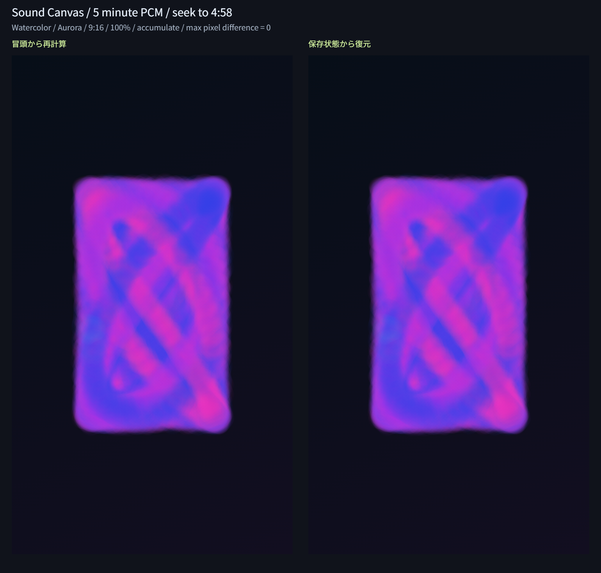

# Issue #14：保存状態によるシークの軽量化

## 実装と判断

15秒ごとと復元完了時の描画状態を再利用する。保存は最大4件、3層CanvasのRGBAと状態JSONの合計見積り48MiB以内に制限し、使われていない古いものからCanvasを解放する。移動先より後の状態は使わない。現在の描画の方が進んでいて移動先以前なら、そのまま続きを描く。

曲・解析版・描画版・スタイル版・設定・比率・シードが変わった保存状態は使わない。読み込み成功時とキー変更時は保存面を解放する。コピーできない場合は保存なしで続け、不正な保存は破棄して冒頭から復元する。

復元を8ms目安・120ステップ以内で分け、進捗と移動先を表示する。中止は現在の設定を保持して0秒の停止画面へ戻す。新しいシーク・設定・曲選択は古い復元を中止する。PNGと通常再生は復元完了まで無効。単一ステップやCanvasコピーの処理時間は分割できないため、8msは厳密な応答時間保証ではない。

15秒間隔は近い位置の後方シークで全曲の描き直しを避けるために採用した。測定では再訪の計算量と待ち時間が減る一方、初回には保存と細かな分割の追加負荷がある。初回も速くなる最適化としては扱わない。

## 比較画像

水彩・Aurora・100%・蓄積・720×1280。左は冒頭から再計算、右は保存状態から再計算した5分の合成音源の298秒位置。実出力をそのまま配置し、色や明るさの補正はない。合成画面・内部3層・スタイル状態は一致した。

## 測定条件

2026-11-12、Windows / Codex内ブラウザ（UA Chrome/157.0.0.0）、ローカルHTTP配信。実Canvas、実AudioEngine・StudioController・Rendererを使用し、音声出力だけは制御可能な時計に置き換えた。描画版はsc-renderer-4のまま。

8kHz・2チャンネルの合成PCMを180秒（1,440,000サンプル）と300秒（2,400,000サンプル）生成して事前解析した。先頭の無音、低音パルス・中高音・強弱変化を含む。解析版はsc-analysis-3、特徴列は5,400/9,000フレーム。解析時間は今回939.1/1,554.8ms（PCM生成込み）。個人の楽曲は含まない。

旧方式相当の比較処理は、毎回0秒へリセットし、全特徴を順に描き、240ステップごとに合成・処理を譲る方法。以前のコントローラーの復元アルゴリズムに合わせた開発用関数であり、公開アプリ全体の計測ではない。

各条件で179/299秒へ初回移動し、保存状態を作った後に178/298秒へ戻る。前後で同じ位置の全RGBAと状態を比較した。時間は単回の壁時計測定で、端末負荷やブラウザ状態で変動する。複数回測定の平均や全環境の性能保証ではない。

## 復元時間と保持量

| スタイル | 曲の長さ | 出力サイズ | 初回・旧方式→今回 (ms) | 再訪・旧方式→今回 (ms) | 保持見積り (MiB) | 件数 |
| --- | ---: | --- | ---: | ---: | ---: | ---: |
| 曲線 | 180秒 | 720×1280 | 383.7 → 531.3 | 369.7 → 47.6 | 42.2 | 4 |
| 曲線 | 300秒 | 720×1280 | 625.3 → 876.6 | 626.3 → 44.6 | 42.2 | 4 |
| 幾何学 | 180秒 | 720×1280 | 201.5 → 361.1 | 213 → 33.4 | 42.19 | 4 |
| 幾何学 | 300秒 | 720×1280 | 342.6 → 606.6 | 355.6 → 33.9 | 42.19 | 4 |
| 粒子 | 180秒 | 720×1280 | 2096 → 2841.5 | 2050.6 → 203.2 | 42.44 | 4 |
| 粒子 | 300秒 | 720×1280 | 3610.8 → 4869.9 | 3517 → 222.1 | 42.44 | 4 |
| 水彩 | 180秒 | 720×1280 | 463.4 → 635.1 | 466.2 → 53.6 | 42.19 | 4 |
| 水彩 | 300秒 | 720×1280 | 769.9 → 1042.5 | 785.5 → 54.9 | 42.19 | 4 |
| 水彩 | 300秒 | 1280×720 | 784.1 → 1039.4 | 789.5 → 52.1 | 42.19 | 4 |
| 水彩 | 300秒 | 1080×1080 | 1038.4 → 1319.9 | 1038.2 → 65.4 | 40.05 | 3 |

再訪では3分音源の5,340ステップ、5分音源の8,940ステップが、どちらも390ステップになった（92.70% / 95.64%削減）。今回の時間では約6.4〜15.9倍の短縮。最寄りの165/285秒の保存状態から13秒分だけを再計算した結果であり、保存が無い時刻への移動すべてに同じ効果が出るとは限らない。

初回は旧方式より遅くなった。保存面のコピーと処理を譲る回数が増えるためであり、表に追加負荷を含めた。初回や保存が退避された遠い場所では、進捗と中止操作を使える。

保持見積りはCanvasの `width×height×4×3` と状態JSON文字数×2の合計。48MiBと4件の両方を守り、正方形では3件、その他では4件を保持した。音声PCM、現在の描画面、復元中や新規保存時の一時コピー、キー文字列やオブジェクト、ブラウザ/GPUの内部領域は含まない。ブラウザ全体の物理メモリ量やピーク使用量を測った値ではない。保存・復元時にはこの表より多いメモリを一時的に使う。

全数値と条件は[測定データ](assets/seek-metrics.json)に保存した。

## 自動・ブラウザ確認

`npm test`：175件成功（既存157件＋キャッシュ11件＋制御7件）。最寄りの過去状態、LRUの解放、3比率の保持上限、同時刻の重複防止、超過サイズ、状態サイズ、キー変更、コピー失敗、clear、現在位置の再利用、保存状態からの後方シーク、通常再生中の保存、曲/設定変更、キャンセル、分割と最後の要求、不正保存からの再計算を確認した。Nodeの描画代替による確認と実Canvasは区別する。

ブラウザでは以下の108ケースが成功した。

- 3分/5分の性能・保持量・冷間と再訪の画素一致：10件。全4スタイルの9:16、追加で水彩5分の16:9と1:1。
- 通常再生中に保存した状態からの後方シーク：4件。各スタイルで20秒から16秒へ戻り、30ステップだけ再計算して一致。
- 連続シーク・設定と曲差替え、中止、旧保存面の解放、不正保存の破棄と完全再計算：4件。
- Issue #13の再現性ページを最適化後に再実行：90件、1,432組。合成と内部3層の画素差0、状態差0を維持。

今回の再実行結果は[最適化後の再現性データ](assets/seek-reproducibility-metrics.json)。Issue #13の元データは履歴としてそのまま残している。詳細条件は[前回の記録](issue-13-validation.md)を参照する。

## 通常画面の操作確認

端末内で生成した5分・8kHz・モノラル16bitの合成WAVを、通常画面のファイル選択から読み込んだ。5:00の長さと解析完了を確認した。299秒へ移動すると進捗21%・移動先4:59・中止ボタンが表示され、再生とPNGが無効になることを確認した。

曲線の299秒位置で粒子へ設定変更し、表示された「中止して最初に戻る」を押すと0秒・停止・粒子選択を保持した。続けて299秒→10秒のシークを行い、最後の10秒で止まることも確認した。最初の移動時の中止ボタンは操作前に復元が完了して消えたため、設定変更による再計算で改めて中止を確認した。

## 再実行と残る範囲

1. ルートで `npm test`。
2. `python -m http.server 8776 --bind 127.0.0.1` で配信。
3. `http://127.0.0.1:8776/tests/reproducibility-browser.html` の90件を実行し、完了後に次へ進む。
4. `http://127.0.0.1:8776/tests/seek-browser.html` で性能検証。同時に他の重い描画試験を実行せず、完了時にPNGと測定データを保存する。
5. `http://127.0.0.1:8776/dist/` で長い合成WAVの読み込み・進捗・中止・連続シークを確認。

ユーザー提供の実音源は端末内に4曲あることを確認した。実音源の保存先と一覧はリポジトリ外のローカルメモで管理し、音源もファイル名一覧もこのPRへ含めない。実音源による最終の読込〜PNG/WebM確認は#18で行う。

主要ブラウザ、実曲、大容量・端末のメモリ制約は#18。動画録画とプレビュー同期は#15/#16、完成PNG専用処理は#17で進める。今回の保持上限をブラウザ全体のメモリ上限や録画時の実時間性能の保証とは扱わない。
