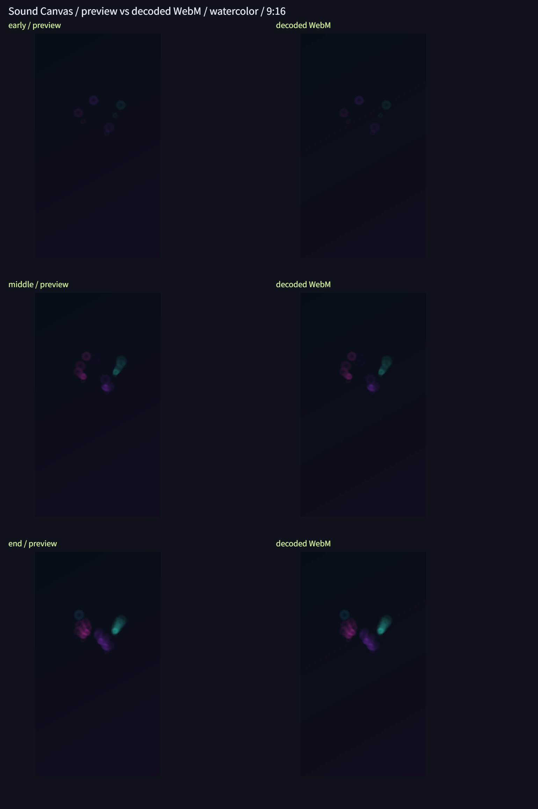

# Issue #16：WebMの同期・画質・3比率

2026-11-12、Windows、Chrome 157のブラウザ環境で実施。製品の描画式・録画処理は変更せず、実際のAudioContext・Canvas captureStream・MediaRecorderから得たVP8/Opusを測定した。自作曲は使用・収録していない。短い合成音の結果であり、長曲・主要PCブラウザの確認は#18で行う。

## 結果

- 同期マーカー3比率、画質4スタイル×3比率の計15件が成功。[測定値JSON](assets/sync-metrics.json)。
- 720×1280、1280×720、1080×1080のTrackEntryとデコード画面を確認。全12動画に3つの基準音があり、冒頭付近・中間・最終画面の36画像で描画を確認した。
- 音と映像の差は−17〜−11ms（映像が先行）。絶対値100ms以下の目標を満たした。録画開始前の余白とは分けて測る。
- 全画面PSNRの最小46.952dB、前景PSNRの最小30.947dB、前景残存率の最小0.760、端の平均絶対誤差の最大0.717。WebMは非可逆圧縮なので画素完全一致は条件としない。細い幾何学模様は圧縮の影響が比較的大きい。
- 実時間録画中にメイン処理を450ms止めると録画を中止し、Blobを破棄。音声・映像トラックとタイマーを解放し、開始前の1.1秒へ停止状態で復帰。その後の通常再生も成功。[中断測定JSON](assets/recording-fault-metrics.json)。`canSave`は復帰後のPNG操作可否であり、途中WebMの保存可否ではない。

左は共通Rendererによる参照画面、右は保存WebMのデコード画面。上から冒頭付近・中間・最終画面。比較図は縮小表示用で、数値判定は元解像度のRGBで行う。

## 同期の測り方

3.113秒・16kHz・モノラルの合成音に0.2、1.4、2.7秒から100msの70/880Hz音を置く。共通解析が検出したbeat（フレーム6/42/81）に白い四角を出す試験専用スタイルを登録する。製品スタイルへの変更はない。3比率で実際に録画し、保存コンテナの時刻を維持したまま音声・映像をWebCodecsでデコードする。

音は1ms窓のRMSが0.07を超える位置（最小間隔0.4秒）、映像は中央の白いマーカーの立ち上がりを検出。3イベントを順に対応させ、映像時刻−音声時刻を測る。解析のビート判定と固定刻みの遅延も含む測定である。

| 出力 | 冒頭付近 | 中間 | 終端付近 |
| --- | ---: | ---: | ---: |
| 720×1280 | −12ms | −11ms | −12ms |
| 1280×720 | −11ms | −17ms | −11ms |
| 1080×1080 | −12ms | −11ms | −12ms |

WebM時刻はClusterと符号付きBlock時刻をTimestampScaleで換算し、CodecDelayを一度だけ引く。Opusはraw packet設定を用い、コンテナの遅延を重ねて適用しない。根拠：[Matroska時刻](https://www.matroska.org/technical/notes.html)、[WebCodecs](https://www.w3.org/TR/webcodecs/)、[Opus登録](https://www.w3.org/TR/webcodecs-opus-codec-registration/)。

## 画質の測り方と許容値

4スタイル×3比率でAurora・反応100%・蓄積を録画。基準音に低中高域の弱い連続音も加える。同じPCM解析結果・シード・設定のRendererを参照にする。音の検出位置から録画内の曲頭位置を推定し、冒頭付近と中間は対応時刻±3ステップ（100ms）の参照候補のうち前景PSNRが最大のものを選ぶ。最終画面は端数を含む全94ステップの完成画面だけと比較する。選んだ参照のずれもJSONに残す（今回33.333〜66.667ms、最終は0）。この候補選択は画質比較のためであり、同期精度の証拠には前節の独立したマーカー測定を使う。

合格条件は全画面PSNR≧30dB、前景PSNR≧20dB、前景残存率≧0.75、外周2%のRGB平均絶対誤差≦8、参照前景が20画素超。背景からのRGB最大差が12を超える参照画素を前景とし、動画側の背景との差が8を超えれば残存と数える。背景が似ているだけの黒画面が通らないよう、前景と端を別に測る。開始直後の余白を含む全フレームの完全一致検証ではない。

デコーダーにWebMのColour（bt709行列・full range・sRGB伝達・bt709原色）を渡す。省略するとこの環境のWebCodecsはlimited rangeとして解釈し、通常のvideo要素での再生と色が異なった。コンテナの情報を反映すると一致したため、比較画素に事後補正は加えていない。読み取りの回帰テストも追加した。[Colour要素](https://www.matroska.org/technical/elements.html)を参照。

## 非表示試験の未確認事項

IABの表示切替、Chromeの別タブ切替・最小化を試したが、自動操作環境では`visibilitychange`も`document.hidden`も発生しなかった。録画は通常完了したため、これは非表示中断の成功とも製品の失敗とも判定しない。試験ページは条件が発生しなければ`applied:false`、`passed:null`と記録する。非表示通知を与えたときの停止・破棄・復帰は既存の自動テストで確認済みだが、通常ブラウザでの実際の非表示通知による確認は残る。

手動では下記の中断試験ページで「非表示テストを開始」を押し、録画進捗を確認してから別タブへ移り、戻る。`visibilityEvents`にhiddenがあり、`applied:true`かつ`passed:true`となることを確認する。自動操作を接続していない通常のブラウザでも確認が必要。#18の実制作フローでこの項目を追跡する。

## 再実行

リポジトリ直下で`python -m http.server 8765 --bind 127.0.0.1`を起動し、以下を開く。録画中に他の重い処理を同時実行しない。

- `http://127.0.0.1:8765/tests/sync-browser.html` →「同期と画質を検証」。完了後にJSONと比較PNGを保存する。約15本分の録画とデコードが必要。
- `http://127.0.0.1:8765/tests/video-fault-browser.html` → 負荷試験と非表示試験を別々に実行。JSONを保存する。
- `npm test`：211件成功。追加7件はコンテナ時刻、BlockGroup、lacing/不正データ拒否、既存実WebMのColour、音の検出時刻、前景欠落検出を確認する。

試験用リーダーはChromium MediaRecorderのVP8/Opus・mono/stereo用。lacing・未対応コーデック・色形式は拒否し、汎用メディアプレーヤーとしては使わない。VP9、他ブラウザ・OS、長時間録画、全テーマ/反応/軌跡の出力画質は今回の測定対象外。[利用時の条件](recording-guide.md)を参照。
