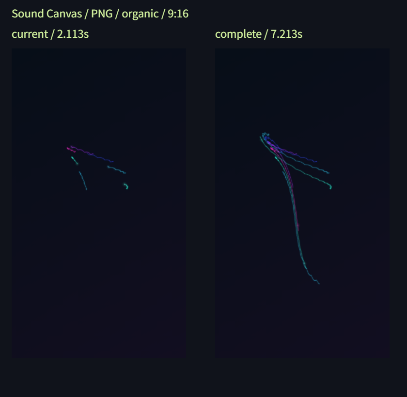

# Issue #17：現在のPNGと曲末の完成アート

2026-11-13、Windows / Chrome 157のブラウザ環境で確認。自作曲は使用・収録せず、合成音と同梱デモを使用した。dev向けの実装で、mainの公開版への反映は別途行う。

## 変更した保存操作

「現在のアートをPNGにする」「曲末の完成アートをPNGにする」を選び、生成後に対象に対応する保存リンクを押す。現在/完成を表示文言・ファイル名・曲名/時刻/画素数で区別する。生成ボタンを押すと一時停止し、生成・中止・失敗後もその位置を保持する。勝手に再生を再開しない。

保存専用のRendererを同じ解析値・シード・設定・解像度で動かす。現在PNGは停止時刻の固定ステップまで、完成PNGは曲末の端数ステップまで描画し、背景・描画・演出を合成する。プレビューやチェックポイントを置き換えず、再計算途中の画像は公開しない。完成アートは曲末時点の画面なので、減衰で消えた軌跡は復活させない。DOM上のボタンやラベルは保存Canvasへ描かない。

再計算は8ms目安・最大120ステップで分割し、進捗と中止を提供する。1ステップやPNG変換を分割する指定ではない。PNG変換待ちは30秒で失敗とし、遅れて届く結果を無視する。録画と同じ排他フラグを使い、読込・再生・設定・シーク・動画開始・重複PNGを拒否する。動画開始側にも別出力の排他確認を追加した。

## ブラウザでの画素・保存確認

[測定JSON](assets/png-metrics.json)：49/49成功。

- 7.213秒・8kHz・モノラルの合成音を事前解析。現在位置は2.113秒（63ステップ）、完成は7.213秒（端数を含む217ステップ）。
- 4スタイル×3比率×現在/完成×蓄積/減衰の48PNGを実際に生成し、createImageBitmapでデコード。蓄積はAurora、減衰はOcean、反応100%を使用した。
- 全PNGが720×1280、1280×720、1080×1080の所定寸法。同じ解析値を順に消費する参照Rendererと全RGBA差0。これは同一環境の比較で、別ブラウザ間の画素一致保証ではない。
- 全48件でプレビューの画素・スタイル内部状態・再生位置を保持し、停止・操作解放を確認。
- 実描画の分割間に生成を中止し、途中PNGなし・元のプレビュー保持・再生成成功を確認（追加1件）。

比較図の文字は確認資料として追加したもの。保存PNG自体には含まない。

アプリ画面では36秒の同梱デモを12秒へシークし、完成PNGを生成・保存後も12秒で停止していることを確認。その後、現在PNGも保存し、表示が36秒の完成対象から12秒の現在対象へ変わった。ダウンロードされた両ファイルのPNGヘッダーも720×1280だった。保存ファイル名は`complete`と`current`で区別された。

## 自動確認

`npm test`：223/223成功。今回の追加はPNG11件、出力排他の動画1件。

現在/完成の別描画と元位置停止、未読込/解析/復元/再生準備中の拒否、別出力との排他、重複開始、描画中/変換中の中止、遅延コールバック、再試行、描画例外、toBlob例外/null、変換期限、URL置換/破棄、ページ終了を確認する。失敗の注入は自動テストで行い、実ブラウザのエンコーダー障害を起こしたという意味ではない。追加JavaScriptの構文と差分の空白も確認。

## 再実行・制限

リポジトリ直下で`python -m http.server 8765 --bind 127.0.0.1`を起動し、`http://127.0.0.1:8765/tests/png-browser.html`の「PNGを検証」を押す。終了後にJSONと比較PNGを保存する。実際の操作は`http://127.0.0.1:8765/dist/`でデモを読み込み、途中へシークして両PNGを生成・保存する。

専用Rendererは冒頭から計算するため、長曲・重いスタイルでは待ち時間が発生する。現在の3層とチェックポイントに加えて、生成中は出力用Canvasと3層も使う。出力面・エンコーダー内部領域・成功Blobはチェックポイント48MiBの上限に含まれない。不要な出力面は終了時に寸法0へ戻し、成功Blob/URLのみ次回生成・読込・ページ終了まで保持する。長曲・実音源・主要PCブラウザは#18で確認し、今回の48通りを全テーマ・全反応値の網羅と扱わない。

生成成功はPNGファイルの準備完了を意味する。ディスクへの保存完了はブラウザのダウンロード表示で確認する。ブラウザ/端末の容量不足など、ダウンロード先の失敗をアプリから保証・判定する機能はない。
