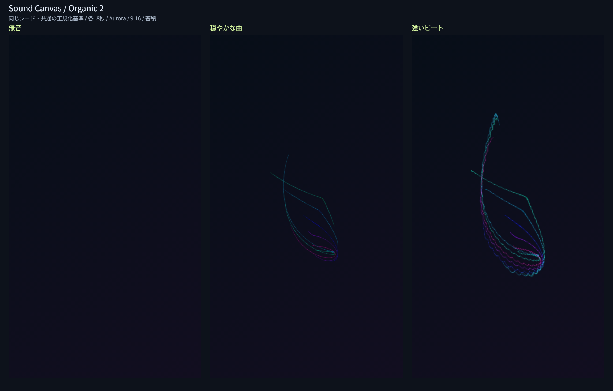

# Issue #8：有機的な曲線の音楽反応と完成アート

## 実装した内容

有機的曲線をorganic-1からorganic-2に更新した。共通の3層・固定刻み・スタイル契約は維持する。

| 音の要素 | 表現 |
| --- | --- |
| 音量 | 線幅、明るさ、不透明度。小さな音も見える応答に調整 |
| 低音 | 曲線の広がり、ビート発光の大きさ |
| 中音 | 移動時計の速度と目標位置への追従 |
| 高音 | 軌跡の上に小さなきらめき |
| ビート | 寿命を持つ一時的な発光 |
| 盛り上がり | 移動速度、きらめきの密度、発光の数 |

初期位相を固定シードから作り、ゆっくり変化する曲線を組み合わせて単調な繰り返しを抑える。位置を慣性で追い、低音の変化がそのまま急な位置飛びにならないようにした。色の重ね方を加算からsource-overに変更し、長時間の交差部分が白くなり続けるのを抑えた。

移動時計・細部の発生余りも保存/復元する。既存版とは形が変わるが、同一新版の再現性を維持する。

## 比較画像

画像はブラウザの実Canvasから書き出した2288×1460のPNG。各パネルは720×1280の出力をそのまま配置した。見やすくするための描画後の色補正は行っていない。

### 確認音源と設定

音源は `tests/organic-fixtures.js` で生成するモノラル22.05kHz・54秒の合成PCM。著作権のある既成曲やユーザーの音源は使用しない。

- 0〜18秒：無音。
- 18〜36秒：220Hzと330Hz、振幅0.035/0.02のゆるやかな和音。前後2秒のフェードを含む。
- 36〜54秒：70Hzの0.5秒間隔の減衰音、440Hzの音、6kHzの細かな音。後半へ強くなる包絡と前後のフェードを含む。

54秒全体を1回解析して共通の正規化基準を作り、各区間の18秒をそれぞれ独立した描画として比較する。Aurora、反応100%、蓄積、9:16、シード2304706556は共通。各音源を別々に正規化して音量差を消した比較ではない。

測定環境：2026-11-12、WindowsのCodex内ブラウザ、UA Chrome/157.0.0.0。解析版sc-analysis-2、スタイル版organic-2。曲識別キーと全条件・測定値は[確認データ](assets/organic-metrics.json)に保存した。

| 区間 | 平均volume | 平均intensity | beat数 | 背景から変化した画素 |
| --- | ---: | ---: | ---: | ---: |
| 無音 | 0 | 0 | 0 | 0 |
| 穏やかな曲 | 0.11285 | 0.11124 | 0 | 8,568（0.930%） |
| 強いビート | 0.34112 | 0.43774 | 35 | 23,885（2.592%） |

変化画素はRGBのいずれかが初期背景から8段階を超えて変化した画素であり、作品の良し悪しを測る値ではない。比較画像は目視でも確認した。穏やかな曲と強いビートで、線の強さ・広がり・細部・軌跡の形が異なる。

## 自動確認

Windows / Node.js v24.15.0で `npm test`：83件成功、失敗0件。新規の曲線15件と既存68件を含む。

曲線テストはCanvasの呼出記録と状態を使い、無音時の非描画、音量と線幅、低音と広がり、中音と速度、高音と細部、beat/intensityと発光、反応設定、3比率の最大反応時の余白、状態復元、10分相当のシミュレーション、不正な復元値、確認PCMの強弱を検証する。Nodeで実画素や実時間再生性能を測定したとは扱わない。

## ブラウザ確認

- 曲線比較ページ：8ケース成功。3区間の描画と曲末保持、強弱の違い、3比率の最大反応時の外周、5分蓄積と末尾の復元を確認した。
- 既存の描画基盤ページ：26ケース成功。3比率×3テーマ×蓄積/減衰の復元・再生成一致、合成順、曲末、合成頻度、3出力解像度のPNG再デコードで画素を比較した。
- 曲線比較の3パネル、最大反応の3比率、長時間の試験で、外周（短辺の2%）に初期背景との差がある画素は0だった。

### 長時間の確認

`organicStress()` の変化する特徴値を5分・9,000フレーム、反応200%、蓄積、180×320で描画した。面積の48.283%が背景から変化し、白い画素（RGBすべて245超）は0、外周の変化は0だった。最後の1秒をスナップショットから復元し、連続生成と全画素・内部状態が一致した。

この試験は小さな実Canvasでの蓄積・状態・色の確認であり、720×1280以上の5分実音源を滑らかに再生・録画できる性能保証ではない。全ての曲で白くならないことや、あらゆる環境で同じ色になることも保証しない。

## 再実行

1. リポジトリのルートで `npm test`。
2. `python -m http.server 8769 --bind 127.0.0.1` でルートを配信する。
3. `http://127.0.0.1:8769/tests/organic-browser.html` で「比較画像と検証を生成」を押す。
4. 成功後、比較PNGと確認データを保存できる。
5. 復元とPNGの回帰確認は同じサーバーの `tests/rendering-browser.html` で行う。

開発用ページはdistに含めず、公開アプリの画面は増やさない。検証結果の更新時は画像・確認データ・本文の条件を同時に更新する。

## 残る確認

実音源での音楽的な反応の評価、他ブラウザ、長曲・大容量の性能は#18、全スタイルの再現性は#13、シークの高速化は#14、動画同期は#16で検証する。幾何学・粒子・水彩の新スタイルは#9〜#11、完成アート専用PNGの操作は#17で実装する。
