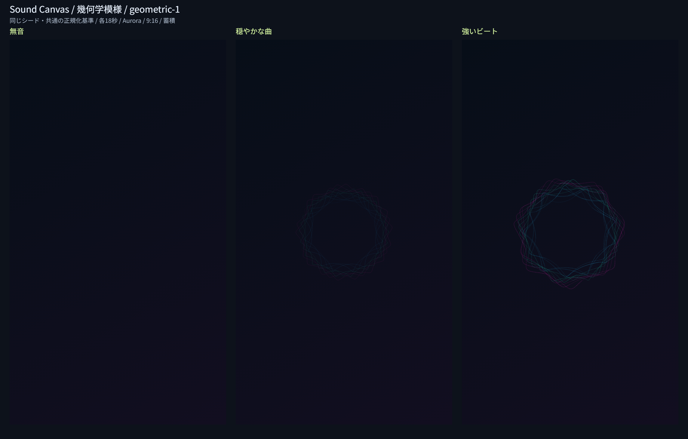

# Issue #9：幾何学模様と単独スタイル切替

## 実装範囲

`geometric-1` を共通のスタイル登録表へ追加した。3本の内トロコイドによるスピログラフ風の軌跡を描く。低音で半径、中音・intensityで速度、高音で細部、音量で線幅・明るさを変え、ビートで回転の加速・円・発光を出す。

回転や半径はdtに沿って変化し、ビートで角度を瞬間的に飛ばさない。角度、回転、半径、発光、円の寿命、前の点、乱数を保存・復元する。蓄積/減衰、背景、テーマ、比率、PNGは既存の描画基盤を利用する。

画面には有機的な曲線と幾何学模様の選択ボタンを用意した。登録表の表示名・説明・記号を使って作り、選択は1種類に限る。初期値は曲線。再生中の切替は現在位置まで再計算し、解析中は無効にする。粒子・水彩と設定全体の仕上げは後続Issueの範囲。

## 比較画像と条件

各パネルは実Canvasの720×1280出力をそのまま配置した。後から明るさや色を補正していない。条件は[曲線の比較](issue-8-validation.md)と同じ合成PCM（22.05kHz・モノラル・54秒、無音→穏やかな和音→低音ビートと細かな高音）。54秒全体を1回解析し、各18秒を独立した作品として同じシード2304706556で描いた。テーマAurora、反応100%、蓄積、9:16。個人音源や外部の楽曲は使わない。

| 区間 | 平均volume | 平均intensity | beat数 | 背景から変化した画素 |
| --- | ---: | ---: | ---: | ---: |
| 無音 | 0 | 0 | 0 | 0 |
| 穏やかな曲 | 0.11285 | 0.11124 | 0 | 8,191（0.889%） |
| 強いビート | 0.34112 | 0.43774 | 35 | 18,290（1.985%） |

変化画素は初期背景からRGBいずれかが8段階を超えて変化した数。作品の質を測る値ではなく、条件差の参考指標とする。画像を目視し、穏やかな区間とビート区間で半径・形・色の密度が異なることを確認した。キー・全条件・測定値は[確認データ](assets/geometric-metrics.json)に保存した。

## 自動確認

2026-11-12、Windows / Node.js v24.15.0。`npm test`：100件成功、失敗0。既存83件と幾何学17件を含む。

幾何学の確認は記録用Canvas代替を使い、登録契約、無音、低音と半径、ビートと加速・発光、中高音の反応、音量・反応設定、全テーマ、3比率の最大反応時の境界、状態と乱数の復元、リセット、演出数の上限、角度循環の連続性、10分相当の有限状態、不正な復元値を確認した。Nodeの確認を実画素の試験とは扱わない。

## ブラウザ確認

WindowsのCodex内ブラウザ、UA Chrome/157.0.0.0、ローカルHTTP配信で実施した。

| 確認ページ | 結果 |
| --- | --- |
| スタイル共通の描画基盤比較 | 49ケース成功 |
| 幾何学の音源比較・境界・5分蓄積 | 8ケース成功 |

49ケースには、3層の基本3ケース、2スタイル×3比率×3テーマ×蓄積/減衰の復元・再生成36ケース、各スタイルの曲末保持と合成頻度4ケース、2スタイル×3解像度のPNG再デコード6ケースを含む。画素と内部状態の一致を確認した。復元試験の解像度は36×64/64×36/48×48、PNGは720×1280/1280×720/1080×1080。

通常画面では以下を確認した。

- 未読込でも幾何学を選択でき、選択したスタイルでデモを読み込める。
- 解析中は2つのスタイルボタンが無効になり、選択状態を保持する。
- デモの幾何学再生、10秒シーク、再生中の幾何学→曲線→幾何学の切替で、位置と再生が維持される。
- 減衰・Ember・16:9へ変更し、曲末で完成表示とPNG保存可能な状態になる。

## 長時間と境界

5分・9,000フレーム、反応200%、180×320、蓄積で合成特徴列を描画した。背景から変化した面積16.411%、白い画素（RGBすべて245超）0、外周（短辺の2%）の変化0、最後の演出円1個。最後の1秒を保存状態から復元し、連続生成と画素・状態が一致した。

最大反応・連続ビートの3出力比率でも外周の変化0を確認した。小さな実Canvasでの5分確認は、フル解像度・長曲の実時間再生や録画の性能保証ではない。

## 再実行

1. ルートで `npm test`。
2. ルートを `python -m http.server 8770 --bind 127.0.0.1` で配信する。
3. `http://127.0.0.1:8770/tests/organic-browser.html?style=geometric` で比較を実行。ページは両スタイル共用で、style指定が無ければ曲線になる。
4. `http://127.0.0.1:8770/tests/rendering-browser.html` で共通の画素・PNG比較を実行。
5. 通常画面 `http://127.0.0.1:8770/dist/` でスタイル切替と再生を確認。

開発用ページはdistへ配信しない。比較画像・測定データ・本文の条件はまとめて更新する。

## 残る確認

実音源の表現評価、他ブラウザ、長曲や大容量の性能は#18。全4スタイルの横断再現性は#13、シークの高速化は#14、動画は#15/#16、完成PNG専用操作は#17で進める。粒子・水彩は#10/#11、4スタイルの設定全体の統合と仕上げは#12で行う。
